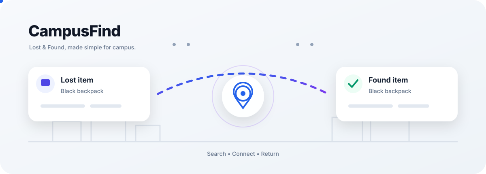

# CampusFind

> **A modern campus Lost & Found portal built with PHP, MySQL, HTML, CSS and JavaScript.**

CampusFind helps students and campus members report lost items, post found items, search listings, contact the person who posted an item, and mark their own listings as returned.

Designed for a simple **XAMPP + MySQL** deployment with a clean responsive interface and **Light/Dark mode**.

<p align="center">
  
</p>

---

## ✨ Highlights

- 🔐 User registration and secure login
- 🚪 Proper logout/session destruction
- 📌 Create **Lost** and **Found** listings
- 🖼️ Optional item photo upload
- 🔎 Search listings by keyword
- 🧩 Filter by type, category and location
- 📄 Detailed item pages
- ✉️ Contact the poster through email
- ✅ Mark your own active item as returned
- 📊 Personal dashboard and **My Posts**
- 🌙 Light/Dark mode with `localStorage`
- 📱 Responsive desktop, tablet and mobile UI
- 🛡️ CSRF protection
- 🔒 Password hashing with PHP password APIs
- 🧰 PDO prepared statements
- 📁 MIME/type and size validation for uploads
- ♿ Reduced-motion support
- 💬 Flash messages and user-friendly error states

---

## 🧭 How CampusFind Works

```text
Register → Login → Dashboard
                    ├── Post Lost
                    ├── Post Found
                    ├── Search / Filter
                    └── My Posts
                           ↓
                     Item Details
                           ↓
                    Contact / Return
```

---

## 🖥️ Main Features

### Authentication

Users can:

- Create an account
- Log in with email and password
- Stay authenticated using PHP sessions
- Log out securely
- Access protected pages only after authentication

Passwords are stored using PHP password hashing APIs rather than plain text.

### Lost & Found Listings

| Field | Description |
|---|---|
| Type | Lost or Found |
| Title | Name/short description |
| Category | Item classification |
| Description | Identifying information |
| Location | Where it was lost/found |
| Date | Relevant date |
| Image | Optional JPG, PNG or WebP |
| Status | Active or Returned |

### Search & Filtering

Users can browse listings and narrow results using:

- Keyword
- Lost / Found type
- Category
- Location
- Status where supported

### Item Management

The owner of a listing can:

- View their posts
- Open item details
- Contact a relevant person
- Mark their own active item as returned

---

## 🎨 UI / UX

CampusFind uses a minimal campus-community visual style:

- Spacious layouts
- Rounded cards
- Clear typography
- Strong primary actions
- Subtle hover and focus interactions
- Responsive navigation
- Mobile-friendly forms
- Empty/error/success states
- Light/Dark theme switching
- Theme persistence through browser `localStorage`
- `prefers-reduced-motion` support

The project-specific animated SVG is:

```text
assets/campusfind-animated.svg
```

---

## 🛠️ Technology Stack

| Layer | Technology |
|---|---|
| Frontend | HTML5 |
| Styling | CSS3 |
| Interactions | Vanilla JavaScript |
| Backend | PHP |
| Database | MySQL / MariaDB |
| Database API | PDO |
| Local Server | XAMPP / Apache |
| Authentication | PHP Sessions |
| Password Security | `password_hash()` / `password_verify()` |
| Theme | CSS variables + `localStorage` |

No frontend framework is required.

---

## 📁 Project Structure

```text
CampusFind_Lost_Found_Portal/
│
├── index.php
├── login.php
├── register.php
├── logout.php
├── dashboard.php
├── post_item.php
├── item.php
├── search.php
├── my_items.php
│
├── config.php
├── database.sql
├── README.md
│
├── partials/
│   ├── head.php
│   ├── header.php
│   ├── footer.php
│   ├── item_card.php
│   └── form_errors.php
│
├── assets/
│   ├── style.css
│   ├── app.js
│   └── campusfind-animated.svg
│
└── uploads/
    └── .gitkeep
```

---

## 🗄️ Database

Default database:

```text
campusfind
```

### `users`

```text
id
name
email
password
created_at
```

### `categories`

```text
id
name
```

Default categories include:

```text
Electronics
ID Cards & Documents
Books & Notes
Bags & Accessories
Clothing
Keys
Jewellery
Stationery
Sports
Other
```

### `items`

```text
id
user_id
category_id
type
title
description
location
item_date
image
status
created_at
updated_at
```

### Relationships

```text
users
  │
  └──────< items >──────> categories
```

One user can create many items, and one category can contain many items.

---

## 🔐 Security

### Password protection

```php
password_hash($password, PASSWORD_DEFAULT);
```

Authentication uses:

```php
password_verify($password, $storedHash);
```

### SQL injection protection

Database operations use PDO prepared statements.

### CSRF protection

State-changing forms include CSRF tokens.

### Output escaping

Dynamic HTML output is escaped with:

```php
e($value)
```

### Image validation

Uploaded images are checked for allowed image types and size.

Supported formats:

```text
JPG
PNG
WebP
```

Maximum application upload size:

```text
5 MB
```

---

## 🚀 Installation with XAMPP

### 1. Start XAMPP

Start:

```text
Apache
MySQL
```

### 2. Copy the project

Place the folder at:

```text
C:\xampp\htdocs\CampusFind_Lost_Found_Portal
```

### 3. Create the database

Open:

```text
http://localhost/phpmyadmin/
```

Import:

```text
database.sql
```

### 4. Check `config.php`

Default XAMPP settings:

```php
$dbHost = 'localhost';
$dbName = 'campusfind';
$dbUser = 'root';
$dbPass = '';
```

Change the password if your MySQL server uses one.

### 5. Open CampusFind

```text
http://localhost/CampusFind_Lost_Found_Portal/
```

---

## 👤 First-Use Flow

1. Create an account.
2. Log in.
3. Open Dashboard.
4. Create a Lost or Found listing.
5. Add item details and an optional photo.
6. Search the listing.
7. Open the item details.
8. Test the contact action.
9. Open My Posts.
10. Mark the item as returned.
11. Log out.
12. Confirm protected pages require login again.

---

## 🧪 Functionality Checklist

### Server

- [ ] Apache starts
- [ ] MySQL starts
- [ ] `campusfind` database exists
- [ ] Tables exist
- [ ] Categories exist

### Authentication

- [ ] Registration works
- [ ] Duplicate email is rejected
- [ ] Incorrect password is rejected
- [ ] Correct login works
- [ ] Logout works
- [ ] Dashboard requires login
- [ ] Post Item requires login
- [ ] My Posts requires login

### Listings

- [ ] Lost listing can be created
- [ ] Found listing can be created
- [ ] Category selection works
- [ ] Description validation works
- [ ] Location validation works
- [ ] Date selection works
- [ ] Image upload works
- [ ] Invalid images are rejected
- [ ] Oversized images are rejected
- [ ] Listing appears after creation

### Search

- [ ] Keyword search works
- [ ] Type filter works
- [ ] Category filter works
- [ ] Location filter works
- [ ] Empty state works
- [ ] Item detail page opens

### User Actions

- [ ] My Posts shows the user's listings
- [ ] Own listing can be marked returned
- [ ] Returned status displays correctly
- [ ] Contact poster action works

### UI

- [ ] Desktop layout works
- [ ] Tablet layout works
- [ ] Mobile layout works
- [ ] Mobile navigation works
- [ ] Light mode works
- [ ] Dark mode works
- [ ] Theme persists after refresh
- [ ] Keyboard focus states work
- [ ] Reduced-motion preference is respected

---

## ⚠️ Common XAMPP Problems

### `Access denied for user 'root'`

Check the MySQL credentials in:

```text
config.php
```

### `Unknown database 'campusfind'`

Import:

```text
database.sql
```

through phpMyAdmin.

### `could not find driver`

Enable PHP's PDO MySQL extension in XAMPP's PHP configuration and restart Apache.

### `Cannot redeclare category_icon()`

A shared helper should only be declared once. If `category_icon()` exists in both `index.php` and `config.php`, remove the duplicate from `index.php` and keep the shared helper in `config.php`.

### Image upload problems

Check that:

```text
uploads/
```

exists and that PHP/Apache can write to it. Also check PHP upload limits.

---

## 🌓 Theme System

The selected theme is stored in:

```text
localStorage
```

CampusFind also supports:

```css
@media (prefers-reduced-motion: reduce)
```

so unnecessary animations can be reduced for users who prefer less motion.

---

## 🎯 Design Principles

**Simple** — posting an item should take only a few steps.

**Clear** — Lost and Found states should be immediately understandable.

**Fast** — searching and filtering should require minimal interaction.

**Responsive** — usable on phones, tablets and desktops.

**Safe** — authentication, database queries, forms and uploads receive basic security protections.

**Maintainable** — reusable partials and shared helpers keep the code organized.

---

## 🔮 Possible Future Improvements

- Email notifications
- In-app messaging
- Admin dashboard
- Listing moderation
- User profiles
- Report/flag listing
- Pagination
- Multiple images
- Image compression
- Claim-request workflow
- Ownership verification
- QR-code item labels
- Campus-specific locations
- REST API
- AJAX search
- Activity notifications
- Audit logs
- Production deployment configuration

---

## 📌 Project Status

**Status:** Functional academic/project prototype

**Environment:** XAMPP / Apache / MySQL

**Backend:** PHP

**Database:** MySQL/MariaDB

**Frontend:** HTML + CSS + Vanilla JavaScript

The project is suitable for local development, demonstration, academic submission and further feature development.

Before public production deployment, review HTTPS, credentials, upload isolation, access control, error reporting and server hardening.

---

## 📄 License

This project can be adapted for educational and development purposes.

Add your preferred license file if you plan to publish the project publicly.

---

## 💡 CampusFind

**Find what was lost. Return what was found.**

<p align="center">
  Built with PHP • MySQL • HTML • CSS • JavaScript
</p>
